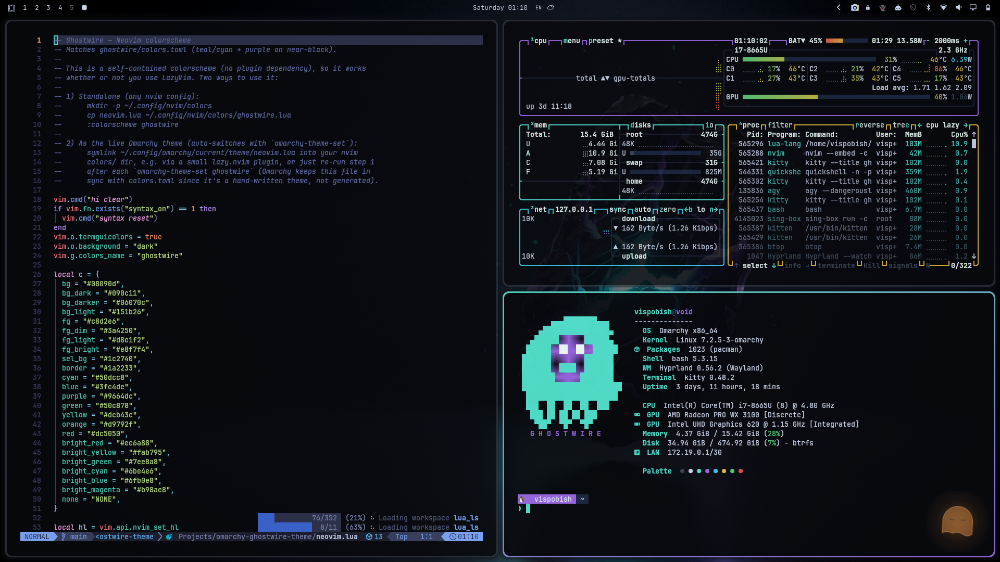
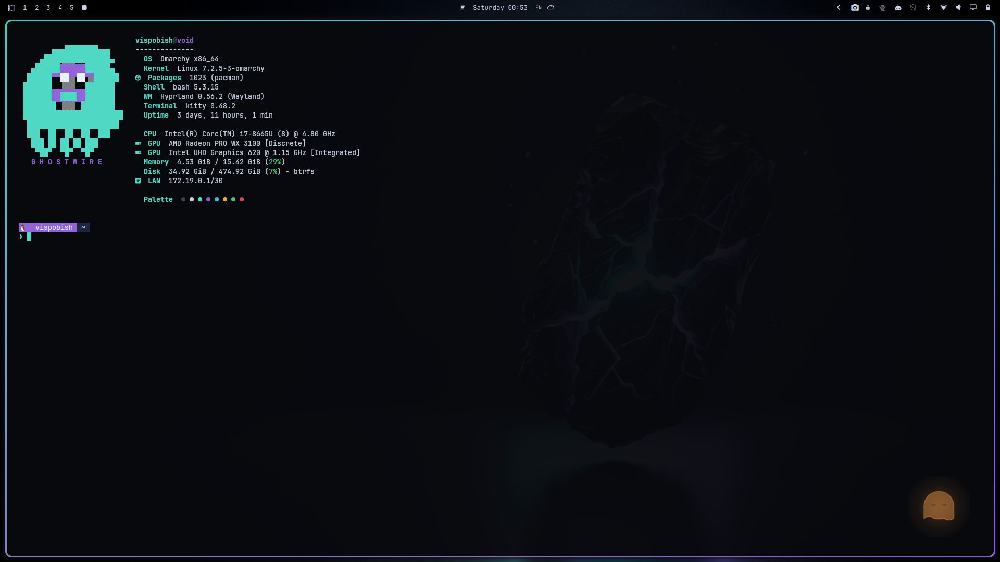
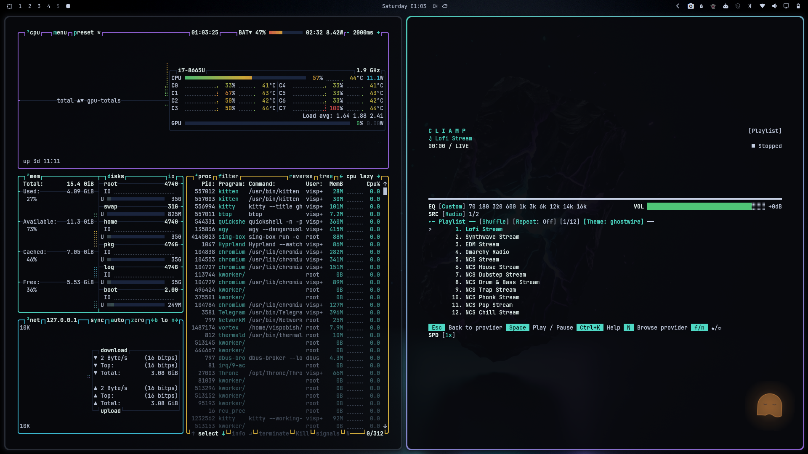
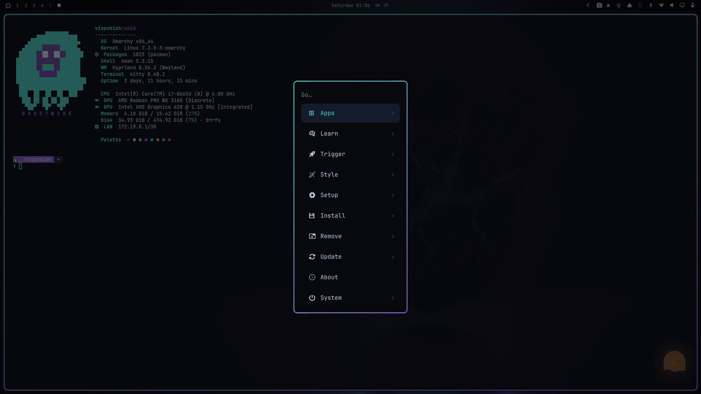
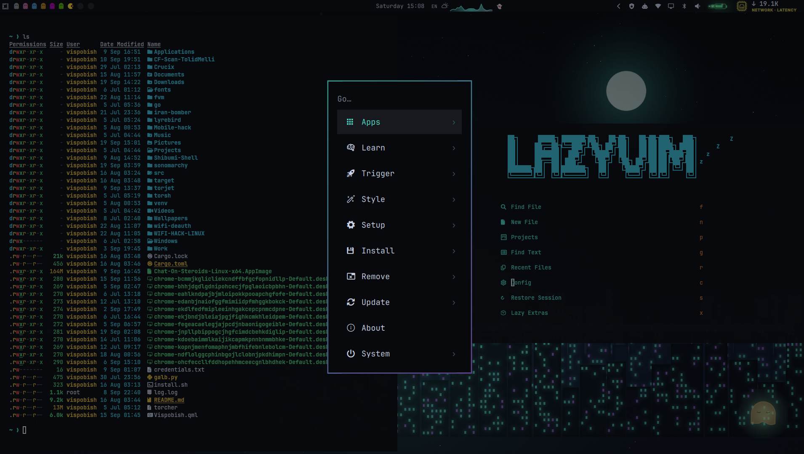
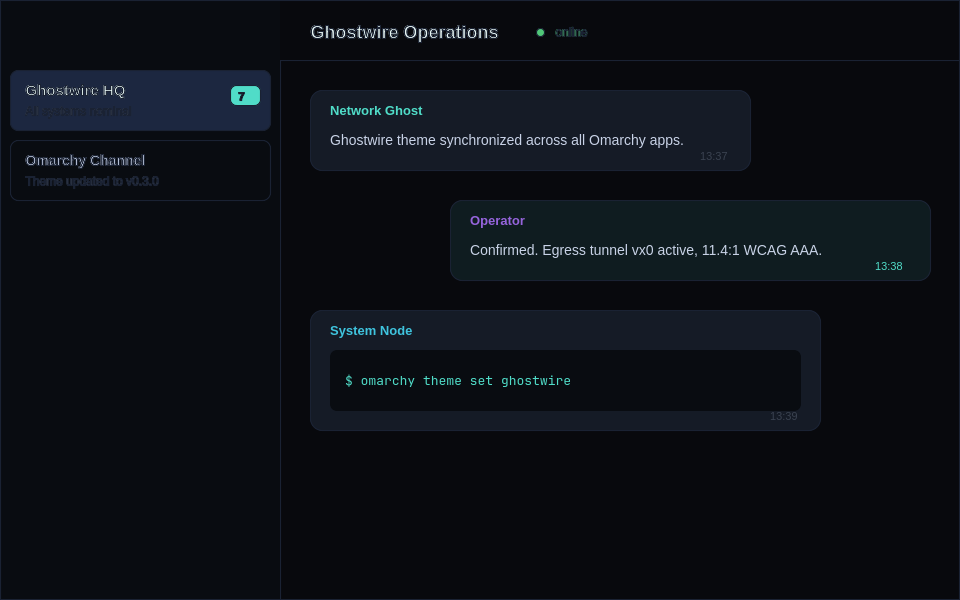
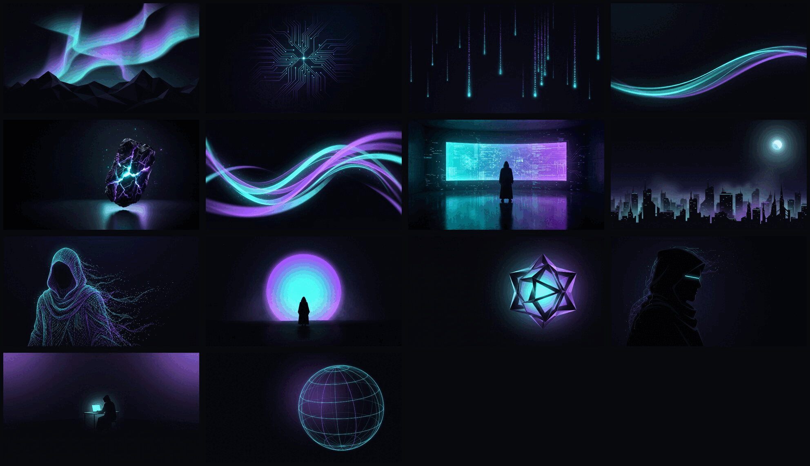

# Ghostwire — Omarchy Theme

[](https://github.com/vispobish01-netizen/omarchy-ghostwire-theme)
[-9664dc?style=flat-square)](scripts/contrast_check.py)
[](scripts/check.sh)
[](LICENSE)


A dark cyan→purple tactical "instrument panel" theme built for Omarchy and Arch Linux. Every component across the terminal, status bar, window manager, editor, browser, and desktop messenger shares a unified identity derived from a single source of truth: `colors.toml`.

---

## ⚡ One-Line Install

```bash
omarchy theme install https://github.com/vispobish01-netizen/omarchy-ghostwire-theme
```

Or from the Omarchy desktop menu:  
`Super + Alt + Space` → **Install > Theme** → paste `https://github.com/vispobish01-netizen/omarchy-ghostwire-theme`.

---

## 🎨 Supported Applications & Coverage Matrix

Every configuration file is synchronized from `colors.toml` via `scripts/generate.py`:

| Category | Application / Target | Configuration File | Status |
|---|---|---|---|
| **Desktop Shell** | Hyprland (Omarchy 4.x) | `hyprland.conf` | ✅ Active (Gradient Borders, Bezier Animations) |
| | Omarchy Quickshell Bar | `shell.toml`, `shell.lock.toml` | ✅ Active (Glass Bar & Scrims) |
| | Waybar | `waybar.css` | ✅ Hand-tuned (Pill Workspaces, Module Accents) |
| | Walker Launcher | `walker.css` | ✅ Hand-tuned (Glass Panel, Cyan Caret) |
| | Hyprlock Screen Lock | `hyprlock.conf`, `unlock.png` | ✅ Hand-tuned (Glitch Clock, Cyan Glow) |
| | Mako Notifications | `mako.ini` | ✅ Hand-tuned (Urgency Borders, Glass Panel) |
| | SwayOSD | `swayosd.css` | ✅ Hand-tuned (Cyan Progress, Purple Capslock) |
| | GTK 3/4 (Libadwaita) | `gtk.css` | ✅ Hand-tuned (Nautilus, Settings, Focus Rings) |
| | Keyboard RGB Backlight | `keyboard.rgb` | ✅ Active (`#50dcc8`) |
| | System Icons | `icons.theme` | ✅ Active (`Yaru-purple-dark`) |
| **Terminals** | Kitty | Auto-generated (`colors.toml`) | ✅ Full 16-color ANSI + tab bar + opacity |
| | Ghostty | Auto-generated (`colors.toml`) | ✅ Full 16-color ANSI + split opacity |
| | Alacritty | Auto-generated (`colors.toml`) | ✅ Full 16-color ANSI + search highlights |
| | WezTerm | `wezterm.lua.example` | ✅ Lua color table |
| **Shell & CLI** | Starship Prompt | `starship.toml` | ✅ Hand-tuned (OS/User/Git/Language pills) |
| | Fastfetch | `fastfetch.jsonc`, `ghostwire-ascii.txt`| ✅ Hand-drawn block logo + custom layout |
| | Fish Shell | `colors.fish` | ✅ Syntax highlighting & pager tokens |
| | fzf | `fzf.fish` | ✅ `FZF_DEFAULT_OPTS` colors & layout |
| | tmux | `tmux.conf` | ✅ Status bar, active windows, pane borders |
| | btop System Monitor | `btop.theme` | ✅ Hand-tuned (Panel outlines, load gradients) |
| | Superfile Manager | `superfile.toml` | ✅ Full file manager colorscheme |
| | Yazi File Manager | `yazi.toml` | ✅ Mode indicators, border styles, selection |
| | Lazygit | `lazygit.yml` | ✅ Commit highlights, border accents |
| | Cava Audio Visualizer | `cava_theme` | ✅ Cyan→Blue→Purple gradient |
| | cliamp Music Player | `cliamp.theme` | ✅ 7-field spectrum theme |
| **Editors** | Neovim | Auto-generated (`colors.toml`) | ✅ Generated colorscheme from `colors.toml` |
| | Visual Studio Code | `vscode-theme/` | ✅ Complete extension theme |
| | Zed Editor | `zed.json` | ✅ Native Zed theme |
| | Obsidian | `obsidian.css` | ✅ Dark workspace, tags, and graph nodes |
| **Web & Chat** | Telegram Desktop | `telegram/ghostwire.tdesktop-theme` | ✅ **NEW:** Complete theme + 52KB dark wallpaper |
| | Telegram Android | `telegram/ghostwire.attheme` | ✅ **NEW:** Android theme + Material variant |
| | Discord (Vencord) | `vencord.theme.css` | ✅ CSS variable recolor |
| | Firefox | `firefox/userChrome.css`, `userContent.css` | ✅ Chrome + new-tab/config styling |
| | Zen Browser | `zen.css` | ✅ Firefox fork theme |
| | Chromium / Chrome | `chromium.theme` | ✅ Managed policy theme |
| | Steam | `steam.css` | ✅ Client CSS accent skin |
| | Spicetify (Spotify) | `spicetify/color.ini` | ✅ Player & sidebar palette |

*(Legacy syntax: `omarchy-theme-install https://github.com/vispobish01-netizen/omarchy-ghostwire-theme`)*

or from the menu: `Super + Alt + Space` → *Install > Theme* → paste that same URL.

Either way Omarchy clones the repo, regenerates terminal (Kitty/Ghostty/
Alacritty), Hyprland, Waybar, Hyprlock, Mako, btop, Walker, and SwayOSD
colors from `colors.toml` automatically, sets `backgrounds/ghostwire.webp`
as your wallpaper, and the native Hyprlock unlock screen picks up
`unlock.png` (see *Lock screen* below).

**Manual / local copy of this folder:**

```bash
mkdir -p ~/.config/omarchy/themes
cp -r omarchy-ghostwire-theme ~/.config/omarchy/themes/ghostwire
omarchy theme set ghostwire
```

Then `Super + Alt + Space` → *Style > Theme* → select **Ghostwire**.

**Getting it listed publicly:** the official route is pinging `@tahayvr` on
the Omarchy Discord (`#omarchy`) to get added to the
[Extra Themes](https://learn.omacom.io/2/the-omarchy-manual/90/extra-themes)
manual page. Third-party galleries like omarchythemes.com appear to mirror
repos tagged with the `omarchy-theme` GitHub topic — add that topic to the
repo once it's public.

## Screenshots

| Desktop Showcase | Fastfetch & Starship |
|---|---|
|  |  |
| Neovim + `btop` + `fastfetch` in Ghostwire theme | Themed terminal with ASCII mascot & Starship prompt |

| btop & cliamp | Omarchy Quick Menu |
|---|---|
|  |  |
| Hand-tuned `btop` & `cliamp` music visualizer | Cyan→purple gradient glass launcher menu |

| Yazi File Manager & Terminal Launcher | Telegram Desktop Theme (WCAG AAA) |
|---|---|
|  |  |
| Fast file navigation & application execution | Tactical dark client with deep-teal outgoing bubbles & 11.4:1 contrast |

### 🖼️ Wallpaper Collection Preview (14 Curated 2560x1440 Backgrounds)


*Cycle through all 14 wallpapers at any time with `omarchy theme bg next` (`Super + Ctrl + Space`).*

## What's inside

- `colors.toml` — the 22 required color keys Omarchy templates everything from
- `preview.png` — desktop preview for the theme gallery / listing
- `unlock.png` + `preview-unlock.png` — native Hyprlock unlock screen image
  and its preview, shown under *Style > Unlock*
- `shell.toml` + `shell.lock.toml` — full Omarchy Quickshell UI theme (bar, popup borders, launcher scrims, and lock screen)
- `keyboard.rgb` — hex `#50dcc8` for hardware RGB keyboard backlights
- `backgrounds/` — fourteen wallpapers, cycle between them with `omarchy theme bg next` (or `Super + Ctrl + Space`):
  - `ghostwire.webp` — default wallpaper: a lone hooded silhouette standing
    before a huge glowing cyan-to-purple halo, dark starfield backdrop
  - `ghostwire-fracture-core.webp` — floating obsidian core with glowing cyan & purple fractures and ambient particle field
  - `ghostwire-mainframe.webp` — deep cyberpunk data vault and server monolith in teal/magenta illumination
  - `ghostwire-prism-core.webp` — refracted crystalline prism dispersing cyan and violet cybernetic rays
  - `ghostwire-light-weave.webp` — flowing dimensional weave of light ribbons and neon cyan filaments
  - `ghostwire-vigil.webp` — close side-profile hooded bust, a thin glowing cyan
    visor slit, faint cyan/purple circuit lines drifting off the hood
  - `ghostwire-watcher-terminal.webp` — a hooded figure seated at a small desk,
    lit only by a glowing laptop screen, in a vast dark room
  - `ghostwire-network-ghost.webp` — a humanoid silhouette built from a glowing
    cyan/purple network-mesh, dissolving into a stream of particles
  - `ghostwire-flow-current.webp` — smooth abstract ribbons of cyan-to-purple
    light flowing across a near-black background
  - `ghostwire-neon-skyline.webp` — cyberpunk city silhouette, glowing cyan/purple
    windows, a soft-glow moon, starfield
  - `ghostwire-code-rain.webp` — Matrix-style falling glyph columns in cyan/purple
  - `ghostwire-aurora-peaks.webp` — low-poly mountain ridgelines under cyan/purple
    aurora ribbons and a starfield
  - `ghostwire-circuit-drift.webp` — glowing PCB-style traces branching outward
    from a central bright node, cyan/purple, starfield background
  - `ghostwire-wireframe-globe.webp` — a tilted 3D wireframe globe, glowing cyan
    with purple longitude lines, starfield backdrop

  All 14 were generated with Google Gemini (Nano Banana)
  from palette-matched prompts, cropped to 16:9, resized to 2560x1440, and
  color-graded locally to match `colors.toml` exactly.
- `icons.theme` — sets file-manager icons to `Yaru-purple-dark` to match the accent
- `btop.theme` — hand-tuned btop theme (not the auto-generated one): purple/cyan/blue/yellow
  box outlines per panel, green→yellow→red load gradients, cyan→blue→purple
  network/process gradients. Drop-in — Omarchy keeps hand-written per-app files as-is
  instead of regenerating them from `colors.toml`.
- `lock-design/` — a **bonus, non-native** glitch-clock lock screen
  (`Ghostwire.qml`, see `lock-design/INSTALL.md`) for the third-party
  "Lock Screen Explorer" Hyprlock plugin. This is separate from the native
  `unlock.png` above — install it only if you already use that plugin.

**Hand-tuned extras beyond what `colors.toml` auto-generates** (Omarchy keeps
any file a theme ships instead of templating it — see [Making your own
theme](https://omarchy.org/manual/making-your-own-theme/)):

- `gtk.css` — GTK4/libadwaita apps (Nautilus, Settings, Text Editor). Omarchy's
  auto-template list covers terminal/Hyprland/Waybar/btop/etc but **not** GTK
  apps, so this fills a real gap rather than just adding polish.
- `waybar.css` — rounded pill workspaces/modules, cyan active-workspace fill,
  per-module color coding (cpu=blue, mem=purple, clock=cyan), blinking red on
  critical battery.
- `walker.css` — glass panel launcher, cyan caret/selection, purple keybind
  chips. Selector IDs follow Walker's default widget tree — check
  `GTK_DEBUG=interactive walker` if your version differs.
- `mako.ini` — per-urgency border colors (dim/cyan/red), rounded glass-panel
  notifications, network/mount category accents.
- `swayosd.css` — rounded OSD popup, cyan progress fill, purple for capslock,
  red for muted.
- `cava_theme` — audio visualizer bars in the cyan→blue→purple identity
  gradient. Merge into `~/.config/cava/config`.
- `cliamp.theme` — theme for the [cliamp](https://github.com/bjarneo/cliamp)
  terminal music player (the widget in the `btop-player.png` screenshot
  above). cliamp's theme format has 7 fields (bg/accent/bright_fg/fg/green/
  yellow/red — `bg` optional, the rest required as `#RRGGBB`), mapped
  straight onto the same hex values as everywhere else. Install:
  `cp cliamp.theme ~/.config/cliamp/themes/ghostwire.toml`, then in cliamp
  press `t` and pick "ghostwire".

These seven are genuine hand-written overrides (not just re-exports of
`colors.toml`), so an `omarchy theme install` from a git copy of this repo
would keep all of them as-is.

## Shell, editor, browser, chat

- `starship.toml` — cross-shell prompt: purple OS/user segment, dark
  directory pill, cyan git branch, yellow git status, cyan/red success/error
  arrow, plus language-version segments (node/python/rust/go) in accent colors.
  Install: `cp starship.toml ~/.config/starship.toml` (or symlink it so it
  follows theme switches).
- `fastfetch.jsonc` + `ghostwire-ascii.txt` — a hand-drawn block-art Ghostwire
  logo (cyan outline, purple shading, bright eyes) with a module list tuned
  for a Hyprland/Omarchy box. Install:
  ```bash
  mkdir -p ~/.config/fastfetch
  cp fastfetch.jsonc ghostwire-ascii.txt ~/.config/fastfetch/
  ```
  then `fastfetch --config ~/.config/fastfetch/fastfetch.jsonc` (or overwrite
  your default `config.jsonc`).
- `vscode-theme/` — a real, standalone VS Code theme extension (not just a
  pointer to someone else's marketplace theme): full `tokenColors` +
  workbench `colors`, covering editor, terminal ANSI colors, git decorations,
  and more. Install locally:
  ```bash
  cp -r vscode-theme ~/.vscode/extensions/ghostwire-theme
  ```
  then reload VS Code and pick **Ghostwire** from the theme picker. (The manual
  copy above is the reliable path for local extension themes unless you later
  publish the extension yourself).
- `chromium.theme` — `13,17,23` (the RGB form of `#08090d`), Omarchy's format
  for theming Chromium/Chrome/Edge/Brave via managed policy.
- `firefox/userChrome.css` + `firefox/userContent.css` — recolors toolbar,
  tabs, URL bar, and Firefox's own pages (new tab, reader mode, PDF viewer).
  Needs `toolkit.legacyUserProfileCustomizations.stylesheets = true` in
  `about:config`, then both files go in `<profile>/chrome/`.
- `vencord.theme.css` — Discord (via Vencord) recolored using Discord's CSS
  variables, so it survives Discord updates. Two selectors near the bottom
  target Discord's hashed classnames (selected-server bar, badges) and *can*
  go stale on a Discord update — if the accents on those two elements stop
  applying, just delete those two rules; the `:root` variables (which cover
  nearly everything) aren't affected. Install: Vencord Settings → Themes →
  drop the file in your themes folder → enable it.

## Explicit configs (beyond `colors.toml` auto-templating)

Omarchy auto-generates terminal/Hyprland/Hyprlock/Waybar/etc from
`colors.toml`, so these aren't required — but shipping them explicitly gives
finer control (opacity, borders, custom Hyprlock layout) than the generic
template, matching what the more detailed community themes ship.

- `hyprland.conf` — explicit border gradient (cyan→purple), rounding, blur,
  and a custom bezier/animation set, instead of the generic template.
- `hyprlock.conf` — a **hand-built native Hyprlock layout**: large centered
  clock, date line, the "state: you are not here" easter egg, and a styled
  input field (cyan outline, purple capslock indicator, red fail state) —
  not just a background swap. Copy to `~/.config/hypr/hyprlock.conf`.
- `colors.fish` + `fzf.fish` — fish shell syntax-highlight colors and fzf's
  `FZF_DEFAULT_OPTS`. Merge into `~/.config/fish/config.fish` or source them
  from there.
- `superfile.toml` — theme for the [Superfile](https://superfile.netlify.app)
  terminal file manager. Copy to `~/.config/superfile/theme/ghostwire.toml`
  and set `theme = "ghostwire"` in Superfile's `config.toml`. Superfile's
  theme keys have changed across versions — if a key is silently ignored,
  check `spf`'s current theme docs.
- `zed.json` — a full [Zed](https://zed.dev) editor theme (editor, terminal
  ANSI colors, syntax highlighting). Copy to `~/.config/zed/themes/ghostwire.json`,
  then pick **Ghostwire** from Zed's theme selector.
- `steam.css` — accent colors for a Steam client CSS loader such as
  [Millennium](https://steambrew.app). Steam's internal class names shift
  between client updates, so treat this as a starting point rather than a
  guaranteed drop-in.
- `zen.css` — a pointer file: [Zen Browser](https://zen-browser.app) uses the
  same `userChrome.css`/`userContent.css` mechanism as Firefox, so the actual
  rules are the `firefox/` files above — copy both into the Zen profile's
  `chrome/` folder. Zen's own accent-color setting (native tab sidebar,
  workspaces) is separate from userChrome and should be set to `#50dcc8`
  manually in Zen's settings.
- `lazygit.yml` — full Lazygit border, commit hash, and git state highlights.
- `yazi.toml` — Yazi modern terminal file manager theme with custom mode indicators.
- `tmux.conf` — tactical tmux status bar with cyan/purple segments.
- `wezterm.lua.example` — WezTerm color scheme table.
- `obsidian.css` — Obsidian markdown workspace, graph nodes, and heading colors.
- `spicetify/color.ini` — Spotify Spicetify theme configuration.

## ✈️ Telegram Theme Suite

Located in [`telegram/`](telegram/):
- **`ghostwire.tdesktop-theme`**: Ready-to-import package containing `colors.tdesktop-theme` and `background.jpg` (darkened low-contrast abstract artwork, only 52KB).
- **`ghostwire.attheme`**: Android Telegram theme.
- **`ghostwire-material.attheme`**: High-contrast Material / Telegram-X variant.
- **WCAG 2.1 AAA Contrast**: Verified text contrast ratio **11.4:1** on message bubbles and **11.9:1** on unread badges.

### How to Apply in Telegram Desktop:
1. Open **Settings (`Ctrl+,`) &rarr; Chat Settings**.
2. Under Chat background, click **Choose from file** and select `telegram/ghostwire.tdesktop-theme` (or send it to Saved Messages and click on it).
3. Click **Apply Changes**.

*(For Flatpak/Snap sandboxes, see [`telegram/README.md`](telegram/README.md) for filesystem access notes).*

## 🛠️ Single-Source Palette Generator & CI Check

Every application theme file is derived directly from [`colors.toml`](colors.toml).

```bash
# Regenerate all 29 theme files from colors.toml:
python3 scripts/generate.py

# Verify synchronization (CI check mode - fails if any file is out of date):
python3 scripts/generate.py --check
./scripts/check.sh

# Run WCAG contrast compliance audit:
python3 scripts/contrast_check.py

# Build Telegram Desktop theme bundle:
./telegram/build.sh
```

## Notes

- Cursor and accent are both set to the cyan (`#50DCC8`) identity color.
- `color5`/`color12` lean toward the purple end of the wallpaper's gradient.
- `preview.png`, `preview-unlock.png`, and `unlock.png` are freshly generated
  procedural art matching this palette.
- The `backgrounds/` wallpapers (see *What's inside* above) were generated
  with Google Gemini (Nano Banana) from palette-matched text prompts, then
  cropped/resized/color-graded locally. They're AI-generated images rather
  than procedural art or licensed photography — if that matters for your use
  case, review Google's Gemini generated-content terms before redistributing.

## License

MIT — see [`LICENSE`](LICENSE). Free to use, modify, and redistribute.
