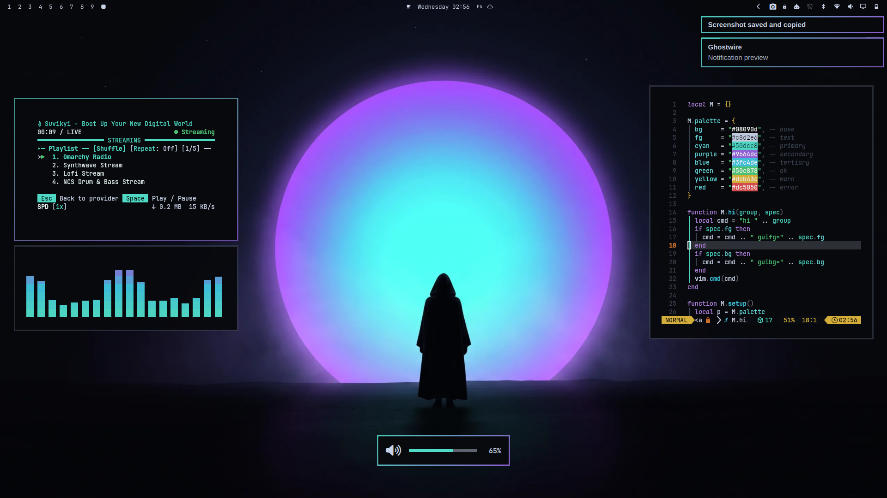

# Ghostwire — Omarchy Theme

[](https://github.com/vispobish01-netizen/omarchy-ghostwire-theme)
[](LICENSE)



A dark cyan→purple tactical "instrument panel" theme built for Omarchy and Arch Linux. Every component across the desktop shell, status bar, window manager, and terminals shares a unified identity derived from a single source of truth: `colors.toml`.


---

## ⚡ One-Line Install

```bash
omarchy theme install https://github.com/vispobish01-netizen/omarchy-ghostwire-theme
```

Or from the Omarchy desktop menu:  
`Super + Alt + Space` → **Install > Theme** → paste `https://github.com/vispobish01-netizen/omarchy-ghostwire-theme`.

---

## 🎨 Supported Applications & Coverage Matrix

All theme colors and styling are driven directly by `colors.toml` and standard Omarchy theme configs:

| Category | Application / Target | Configuration File | Status |
|---|---|---|---|
| **Desktop Shell** | Hyprland (Omarchy 4.x) | `hyprland.conf` | ✅ Active (Gradient Borders, Bezier Animations) |
| | Omarchy Quickshell Bar | `shell.toml`, `shell.lock.toml` | ✅ Active (Glass Bar & Scrims) |
| | Waybar | `waybar.css` | ✅ Hand-tuned (Pill Workspaces, Module Accents) |
| | Walker Launcher | `walker.css` | ✅ Hand-tuned (Glass Panel, Cyan Caret) |
| | Hyprlock Screen Lock | `hyprlock.conf`, `unlock.png` | ✅ Hand-tuned (Glitch Clock, Cyan Glow) |
| | Mako Notifications | `mako.ini` | ✅ Hand-tuned (Urgency Borders, Glass Panel) |
| | SwayOSD | `swayosd.css` | ✅ Hand-tuned (Cyan Progress, Purple Capslock) |
| | Keyboard RGB Backlight | `keyboard.rgb` | ✅ Active (`#50dcc8`) |
| | System Icons | `icons.theme` | ✅ Active (`Yaru-purple-dark`) |
| | Chromium / Chrome | `chromium.theme` | ✅ Managed policy theme |
| | btop System Monitor | `btop.theme` | ✅ Hand-tuned (Panel outlines, load gradients) |
| **Terminals** | Kitty | Auto-generated (`colors.toml`) | ✅ Full 16-color ANSI + tab bar + opacity |
| | Ghostty | Auto-generated (`colors.toml`) | ✅ Full 16-color ANSI + split opacity |
| | Alacritty | Auto-generated (`colors.toml`) | ✅ Full 16-color ANSI + search highlights |
| **Editors** | Neovim | Auto-generated (`colors.toml`) | ✅ Generated colorscheme from `colors.toml` |

*(Legacy syntax: `omarchy-theme-install https://github.com/vispobish01-netizen/omarchy-ghostwire-theme`)*

or from the menu: `Super + Alt + Space` → *Install > Theme* → paste that same URL.

Either way Omarchy clones the repo, regenerates terminal (Kitty/Ghostty/Alacritty), Hyprland, Waybar, Hyprlock, Mako, btop, Walker, and SwayOSD colors from `colors.toml` automatically, sets `backgrounds/ghostwire.webp` as your wallpaper, and the native Hyprlock unlock screen picks up `unlock.png`.

**Manual / local copy of this folder:**

```bash
mkdir -p ~/.config/omarchy/themes
cp -r omarchy-ghostwire-theme ~/.config/omarchy/themes/ghostwire
omarchy theme set ghostwire
```

Then `Super + Alt + Space` → *Style > Theme* → select **Ghostwire**.

## What's inside

- `colors.toml` — the 22 required color keys Omarchy templates everything from
- `preview.png` — desktop preview for the theme gallery / listing
- `unlock.png` + `preview-unlock.png` — native Plymouth/Hyprlock unlock screen image and its preview, shown under *Style > Unlock*
- `shell.toml` + `shell.lock.toml` — full Omarchy Quickshell UI theme (bar, popup borders, launcher scrims, and lock screen)
- `keyboard.rgb` — hex `#50dcc8` for hardware RGB keyboard backlights
- `icons.theme` — sets file-manager icons to `Yaru-purple-dark` to match the accent
- `btop.theme` — hand-tuned btop theme: purple/cyan/blue/yellow box outlines per panel, green→yellow→red load gradients, cyan→blue→purple network/process gradients
- `chromium.theme` — RGB form of background color (`8,9,13`), Omarchy's format for theming Chromium/Chrome/Edge/Brave via managed policy
- `hyprland.conf` — explicit border gradient (cyan→purple), rounding, blur, and custom bezier/animation curves
- `hyprlock.conf` — hand-built native Hyprlock layout with centered clock, date line, and styled input field
- `waybar.css` — rounded pill workspaces/modules, cyan active-workspace fill, per-module color accents
- `walker.css` — glass panel launcher, cyan caret/selection, purple keybind chips
- `mako.ini` — per-urgency border colors (dim/cyan/red), rounded glass-panel notifications
- `swayosd.css` — rounded OSD popup, cyan progress fill, purple for capslock, red for muted
- `backgrounds/` — fourteen 2560x1440 WebP wallpapers, cycle between them with `omarchy theme bg next` (or `Super + Ctrl + Space`):
  - `ghostwire.webp` — default wallpaper: a lone hooded silhouette standing before a glowing cyan-to-purple halo
  - `ghostwire-fracture-core.webp` — floating obsidian core with glowing cyan & purple fractures and ambient particle field
  - `ghostwire-mainframe.webp` — deep cyberpunk data vault and server monolith in teal/magenta illumination
  - `ghostwire-prism-core.webp` — refracted crystalline prism dispersing cyan and violet cybernetic rays
  - `ghostwire-light-weave.webp` — flowing dimensional weave of light ribbons and neon cyan filaments
  - `ghostwire-vigil.webp` — close side-profile hooded bust, a thin glowing cyan visor slit
  - `ghostwire-watcher-terminal.webp` — a hooded figure seated at a small desk, lit only by a glowing laptop screen
  - `ghostwire-network-ghost.webp` — a humanoid silhouette built from a glowing cyan/purple network-mesh
  - `ghostwire-flow-current.webp` — smooth abstract ribbons of cyan-to-purple light flowing across a dark background
  - `ghostwire-neon-skyline.webp` — cyberpunk city silhouette, glowing cyan/purple windows, soft-glow moon
  - `ghostwire-code-rain.webp` — falling glyph columns in cyan/purple
  - `ghostwire-aurora-peaks.webp` — low-poly mountain ridgelines under cyan/purple aurora ribbons
  - `ghostwire-circuit-drift.webp` — glowing PCB-style traces branching outward from a central bright node
  - `ghostwire-wireframe-globe.webp` — a tilted 3D wireframe globe, glowing cyan with purple longitude lines

## Notes

- Cursor and accent are both set to the cyan (`#50DCC8`) identity color.
- `color5`/`color12` lean toward the purple end of the wallpaper's gradient.
- `preview.png`, `preview-unlock.png`, and `unlock.png` are freshly generated procedural art matching this palette.
- The `backgrounds/` wallpapers were generated from palette-matched text prompts, then cropped/resized/color-graded locally to 2560x1440 WebP.

## License

MIT — see [`LICENSE`](LICENSE). Free to use, modify, and redistribute.
